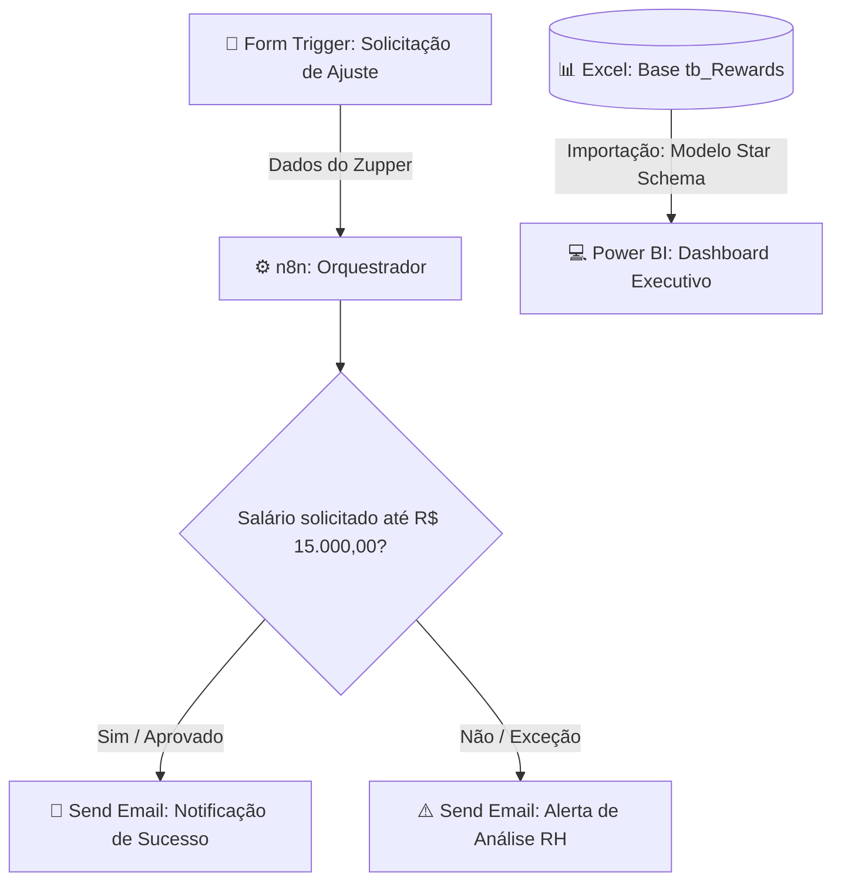

# 🚀 Rewards & People Analytics Pipeline — Zup Innovation

Este repositório contém uma solução integrada de **People Analytics & Automação de Processos** desenvolvida para a área de **Rewards (Remuneração e Benefícios)**.

O projeto simula um ecossistema completo end-to-end: tratamento de dados de colaboradores, cálculo de competitividade salarial (**Compa-Ratio**), monitoramento executivo via **Power BI** e orquestração de fluxos de aprovação com **n8n**.

---

## 🏗️ Arquitetura da Solução

## 📂 Módulos do Projeto

### 1. Módulo Excel & Engenharia de Dados (`/data`)

- Base de dados simulando **150 Zuppers** em áreas cruciais: Engenharia, Data & AI, Produto, Design e Rewards.
- Criação de regras de negócio de RH:
  - **Compa-Ratio:** Salário Atual / Midpoint de Mercado.
  - **Status de Enquadramento:** salários abaixo de 85% são classificados como **Abaixo do Piso**; de 85% a 115%, inclusive, como **Enquadrado**; acima de 115%, como **Acima do Teto**.

### 2. Módulo Power BI (`/powerbi`)

- **Modelagem Star Schema:** separação entre tabela Fato (`tb_Rewards`) e Dimensão (`dCargos`).
- **Medidas DAX:** métricas de Headcount, Custo Total de Pessoas, Folha Salarial e Compa-Ratio Médio.
- **UX/UI:** formatação condicional para rápida identificação de riscos de turnover e discrepâncias orçamentárias.

### 3. Módulo n8n & Automação (`/n8n`)

- Workflow orquestrado no **n8n**, rodando via container Docker.
- **Form Trigger:** captura de solicitações de alteração salarial.
- **If Node:** regra de negócio automatizada para aprovações diretas de salários solicitados menores ou iguais a **R$ 15.000,00**.
- **Send Email:** notificações dinâmicas para o solicitante e alertas de exceção para o time de Rewards.

## 🛠️ Tecnologias Utilizadas

- **Orquestração Low-Code:** n8n (Docker).
- **Visualização de Dados:** Power BI & DAX.
- **Manipulação de Dados:** Excel / Python (Pandas).
- **Versionamento & Governança:** Git & GitHub.

## 🚀 Como Executar o Workflow do n8n

1. Baixe o arquivo `workflow_rewards.json`, localizado na pasta `/n8n`.
2. No seu n8n local, importe o arquivo pelo menu de importação de workflows.
3. Configure as credenciais e conexões necessárias, incluindo o serviço de envio de e-mails.
4. Execute o workflow em modo de teste e envie uma solicitação pelo formulário para validar o fluxo.
